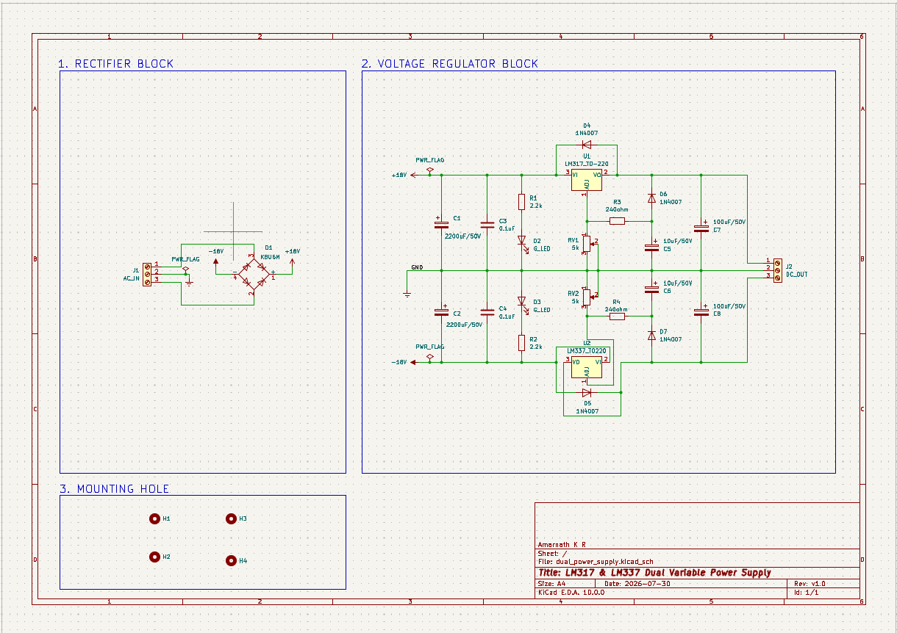
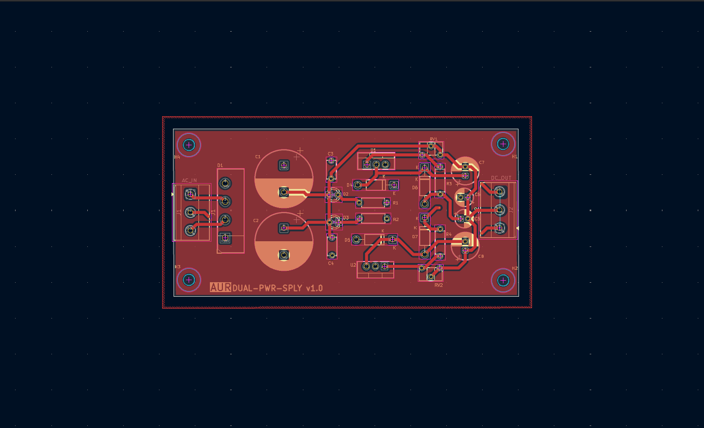
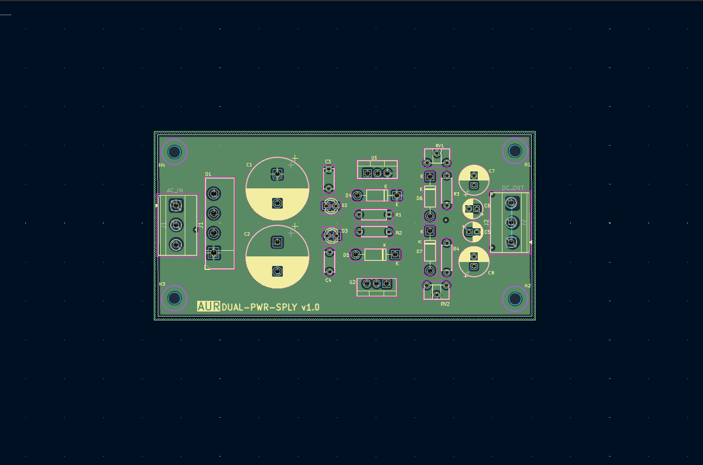
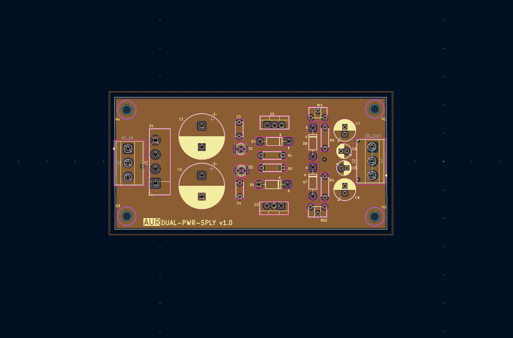
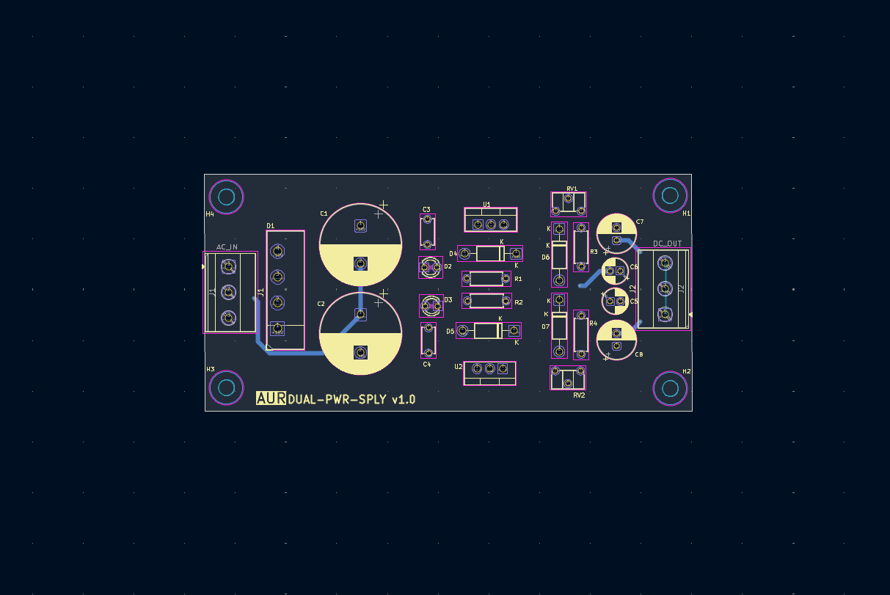
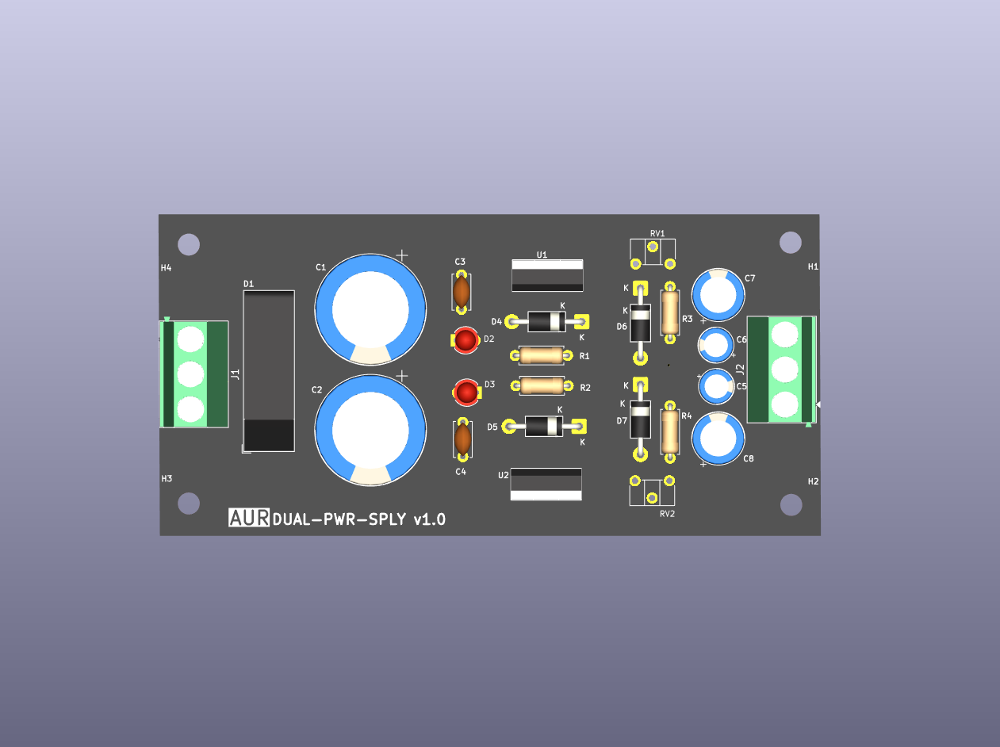
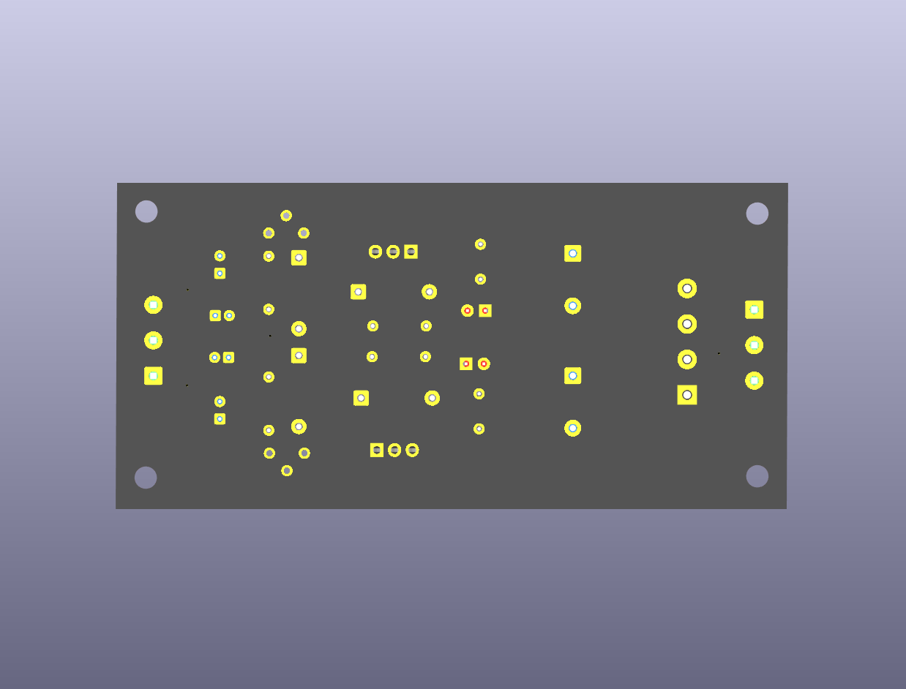

# Adjustable Dual Power Supply (±1.25 V to ±27 V) using LM317 and LM337

---

# Table of Contents

- [Overview](#overview)
- [Features](#features)
- [Specifications](#specifications)
- [Circuit Design](#circuit-design)
- [Complete Circuit Description](#complete-circuit-description)
- [PCB Design](#pcb-design)
- [Bill of Materials (BOM)](#bill-of-materials-bom)

---

# Overview

This project implements an **adjustable dual-rail linear DC power supply** using the **LM317T** (positive rail) and the **LM337T** (negative rail) adjustable voltage regulators.

A center-tapped AC transformer feeds a bridge rectifier and two large filter capacitors, creating a positive and a negative unregulated rail. Each rail is regulated independently by its own regulator and adjusted with its own potentiometer, giving a symmetric **+V / GND / −V** output suitable for op-amp circuits, audio preamplifiers and general analog bench work.

The complete schematic and PCB were designed in **KiCad**.

---

# Features

- Independent adjustable positive and negative rails
- LM317T positive regulator and LM337T negative regulator
- Full-wave bridge rectifier
- Two large input smoothing capacitors (one per rail)
- High-frequency input bypass capacitors
- ADJ bypass capacitors for improved ripple rejection
- Output stabilization capacitors
- Reverse and ADJ protection diodes on both rails
- Power indicator LED for each rail
- 3-pin screw terminals for AC input and DC output
- Two-layer PCB
- Mounting holes at all four corners

---

# Specifications

| Parameter | Value |
|-----------|-------|
| Input Voltage | Center-tapped AC transformer |
| Output Voltage | Approximately ±1.25 V to ±27 V* |
| Positive Regulator | LM317T |
| Negative Regulator | LM337T |
| Rectifier | KBU6M Bridge Rectifier |
| Voltage Adjustment | 5 kΩ potentiometer per rail |
| PCB | 2 Layer |
| Software | KiCad |

\*Maximum output voltage depends on the transformer voltage, regulator dropout voltage (about 2–3 V) and load current. The output cannot exceed the unregulated rail minus dropout.

---

# Circuit Design

The complete circuit is divided into four functional blocks.

1. Input Power Stage
2. Positive Regulation Stage (LM317)
3. Negative Regulation Stage (LM337)
4. Output Stage

---

# 1. Input Power Stage

The input stage converts AC from the transformer into two filtered DC rails.

It consists of

- Bridge Rectifier (D1)
- C1, C2 (2200 µF each)
- C3, C4 (100 nF each)

### Bridge Rectifier

The **KBU6M** bridge rectifier (6 A / 1000 V) converts the transformer output into pulsating DC using full-wave rectification.

With the transformer center tap connected to ground, the bridge produces a positive rail and a negative rail referenced to ground.

---

### C1 and C2

**Value : 2200 µF / 50 V**

Each capacitor smooths one rail. The ripple voltage is approximately

```
Vr = I / (f_ripple × C)
```

where

- I = Load Current
- f_ripple = Ripple Frequency (100 Hz for 50 Hz mains)
- C = Filter Capacitance

For example, at a 0.5 A load:

```
Vr = 0.5 / (100 × 2200 µF)
Vr ≈ 2.3 V (peak-to-peak)
```

The LM317 and LM337 reject most of this ripple, but the input must never dip below the regulator's dropout level, so the capacitance and transformer voltage must leave enough margin.

---

### C3 and C4

**Value : 100 nF Ceramic**

Electrolytic capacitors are ineffective at high frequencies because of their ESR and inductance.

A **100 nF** ceramic capacitor is placed near each regulator input to suppress high-frequency noise and improve regulator stability, as recommended in the LM317 and LM337 datasheets.

---

# 2. LM317 Positive Regulator Design

The LM317 maintains approximately

```
V_REF = 1.25 V
```

between the OUT and ADJ terminals.

The output voltage is

```
V_OUT = 1.25 × (1 + R_ADJ / R3) + I_ADJ × R_ADJ
```

Since I_ADJ is about 50 µA, its contribution is small and can be neglected for a first estimate.

```
V_OUT ≈ 1.25 × (1 + R_ADJ / R3)
```

---

### R3

**Value : 240 Ω**

The LM317 datasheet recommends

```
R3 = 240 Ω
```

The current through R3 becomes

```
I = 1.25 / 240
I ≈ 5.2 mA
```

This provides the regulator's minimum load current while keeping power dissipation low.

---

### RV1

**Value : 5 kΩ Potentiometer**

RV1 forms the adjustable arm of the divider.

```
V_OUT(min) = 1.25 × (1 + 0 / 240)    = 1.25 V
V_OUT(max) = 1.25 × (1 + 5000 / 240) ≈ 27.3 V
```

---

# 3. LM337 Negative Regulator Design

The LM337 is the negative counterpart of the LM317. It maintains

```
V_REF = −1.25 V
```

between its OUT and ADJ terminals.

```
V_OUT = −1.25 × (1 + R_ADJ / R4) − I_ADJ × R_ADJ
```

---

### R4

**Value : 240 Ω**

The same 240 Ω programming resistor is used, giving about 5.2 mA through R4.

---

### RV2

**Value : 5 kΩ Potentiometer**

```
V_OUT(min) = −1.25 V
V_OUT(max) ≈ −27.3 V
```

Because both rails use identical resistor values, the positive and negative outputs track closely in magnitude. They are adjusted independently, so they can also be set to different voltages.

> **⚠️ Important:** The LM337 pinout is **different** from the LM317. For the TO-220 package, the LM317 is ADJ / OUT / IN and the LM337 is ADJ / IN / OUT (pin 1 to pin 3). Verify the footprint pin mapping against the datasheet.

---

# 4. Indicator LEDs

**R1 and R2 : 2.2 kΩ**

Each green LED (D2, D3) is driven through a series resistor.

```
I_LED = (V − V_F) / R
```

For a 12 V supply and V_F ≈ 2 V:

```
I_LED = (12 − 2) / 2.2 kΩ
I_LED ≈ 4.5 mA
```

This gives clearly visible brightness at low current. The current rises with higher rail voltage, so check the resistor's power rating when the rail is set high.

---

# 5. Capacitor Selection

| Component | Value | Purpose |
|-----------|-------|---------|
| C1, C2 | 2200 µF / 50 V | Input ripple filtering (one per rail) |
| C3, C4 | 100 nF | High-frequency input bypass |
| C5, C6 | 10 µF / 50 V | ADJ bypass, improves ripple rejection |
| C7, C8 | 100 µF / 50 V | Output stability and transient response |

---

# 6. Protection Circuit Design

Four 1N4007 diodes protect the regulators, following the LM317 and LM337 datasheet recommendations.

---

## D4 and D5 (Output → Input)

If the input supply is suddenly removed, the output capacitor may discharge backwards through the regulator.

D4 and D5 bypass this reverse current and protect the regulators.

---

## D6 and D7 (ADJ → Output)

The ADJ bypass capacitor stores charge. Without protection, it may discharge through the regulator's ADJ pin when the output is shorted or collapses.

D6 and D7 safely redirect this discharge current.

---

# 7. Thermal Considerations

The regulators dissipate the difference between input and output voltage multiplied by the load current.

```
P_D = (V_IN − V_OUT) × I_LOAD
```

For example, with 30 V at the input, 5 V at the output and 1 A of load:

```
P_D = (30 − 5) × 1 = 25 W
```

This is far beyond what an unmounted TO-220 can handle. A heatsink is required for any significant load current at low output voltages.

> **📝 Note:** The LM317 tab is connected to **VOUT** and the LM337 tab is connected to **negative VIN**. They are at different potentials. Use **separate heatsinks**, or insulate each regulator with a mica or silicone pad and a nylon shoulder washer, to avoid shorting the rails.

---

# Complete Circuit Description

The center-tapped AC transformer is connected to the 3-pin AC input terminal. The **KBU6M** bridge rectifier converts it into pulsating DC, and the two **2200 µF** capacitors smooth the positive and negative rails.

A **100 nF** ceramic capacitor at each regulator input filters high-frequency noise before the voltage reaches the LM317 and LM337.

The LM317 regulates the positive rail using a **240 Ω** programming resistor and a **5 kΩ** potentiometer. The LM337 regulates the negative rail with an identical network.

A **10 µF** ADJ capacitor on each regulator improves ripple rejection, while a **100 µF** output capacitor on each rail enhances transient response and stability.

Protection diodes D4 to D7 safeguard both regulators against reverse capacitor discharge. Green LEDs indicate that each rail is powered.

The regulated +V, GND and −V outputs are available on the 3-pin DC output terminal.

---

# PCB Design

The PCB was designed using **KiCad**.

The design follows a functional block layout where power flows from the left side of the PCB towards the right.

```
AC Input (J1)
    │
Bridge Rectifier (D1)
    │
Input Filters (C1, C2)
    │
LM317 / LM337 Regulators
    │
Adjust Networks (RV1, RV2)
    │
Output Capacitors
    │
DC Output (J2)
```

The positive and negative sections are laid out as mirror images of each other, which keeps trace lengths balanced and simplifies routing.

---

## PCB Design Considerations

### Functional Component Placement

Components were grouped according to their electrical function.

- Input Stage
- Positive Regulation Stage
- Negative Regulation Stage
- Output Stage

---

### Regulator Placement

The TO-220 regulators are placed in the center of the board so that a screw-on or clip-on heatsink can be attached to each tab. Keep clearance around each regulator for the heatsink body and fastening hardware.

---

### Mechanical Features

- Four mounting holes at the corners
- Screw terminals for AC input and DC output
- Version marking on the silkscreen (DUAL-PWR-SPLY v1.0)

---

# PCB Images

### Schematic

<p align="center">
  
</p>

### Copper Layers

<div align="center">
  <table>
    <tr>
      <td align="center">
        <br>
        <b>Front Copper Layer</b>
      </td>
      <td align="center">
        <br>
        <b>Inner 1 Copper Layer</b>
      </td>
    </tr>
    <tr>
      <td align="center">
        <br>
        <b>Inner 2 Copper Layer</b>
      </td>
      <td align="center">
        <br>
        <b>Back Copper Layer</b>
      </td>
    </tr>
  </table>
</div>


### 3D Model

<p align="center">
  
  
</p>
---

# Bill of Materials (BOM)

| Reference | Qty | Value | Footprint | Description |
|-----------|-----|-------|-----------|-------------|
| C1, C2 | 2 | 2200 µF / 50 V | CP_Radial_D16.0mm_P7.50mm | Input Filter Capacitors |
| C3, C4 | 2 | 100 nF | C_Disc_D5.0mm_W2.5mm_P5.00mm | Input Bypass Capacitors |
| C5, C6 | 2 | 10 µF / 50 V | CP_Radial_D5.0mm_P2.00mm | ADJ Capacitors |
| C7, C8 | 2 | 100 µF / 50 V | CP_Radial_D7.5mm_P2.50mm | Output Capacitors |
| D1 | 1 | KBU6M | Diode_Bridge_Vishay_KBU | Bridge Rectifier |
| D2, D3 | 2 | Green LED | LED_D3.0mm | Rail Indicators |
| D4, D5, D6, D7 | 4 | 1N4007 | D_DO-41_P10.16mm_Horizontal | Reverse and ADJ Protection |
| J1 | 1 | AC_IN | Phoenix MKDS-1,5-3-5.08 | AC Input Terminal |
| J2 | 1 | DC_OUT | Phoenix MKDS-1,5-3-5.08 | DC Output Terminal |
| R1, R2 | 2 | 2.2 kΩ | R_Axial_DIN0207_P7.62mm | LED Current Limiting |
| R3, R4 | 2 | 240 Ω | R_Axial_DIN0207_P7.62mm | Regulator Programming Resistors |
| RV1, RV2 | 2 | 5 kΩ | Potentiometer_ACP_CA6-H2,5 | Voltage Adjustment |
| U1 | 1 | LM317T | TO-220-3_Vertical | Positive Adjustable Regulator |
| U2 | 1 | LM337T | TO-220-3_Vertical | Negative Adjustable Regulator |

> **📝 Note:** Some components such as the KBU6M bridge rectifier, etc. were chosen because they were already available, not because they were mandatory. Equivalent parts can be substituted without changing the design.

---

# Software Used

- KiCad
- KiCad PCB Editor
- KiCad 3D Viewer

---

# Manufacturing Files

The repository includes

- KiCad Project Files
- Schematic
- PCB Layout
- Footprint Libraries
- Gerber Files
- Drill Files
- Bill of Materials (BOM)

---

# Future Improvements

Possible future enhancements include

- Panel-mount potentiometers via wire pads
- Digital voltmeter and ammeter for each rail
- Adjustable current limiting
- Heatsink mounting provision with isolation
- Fixed ±5 V / ±12 V selection switch
- Cooling fan control

---

# Repository Structure

```
LM317-LM337-Dual-Power-Supply/
│
├── README.md
├── LICENSE
├── Schematic/
├── PCB/
├── Gerbers/
├── BOM/
├── Images/
└── Datasheets/
```

---

# References

1. Texas Instruments – LM317 Adjustable Voltage Regulator Datasheet
2. Texas Instruments – LM337 Negative Adjustable Regulator Datasheet
3. Vishay – KBU6 Bridge Rectifier Datasheet
4. KiCad Documentation

---

# License

This project is licensed under the **MIT License**.
